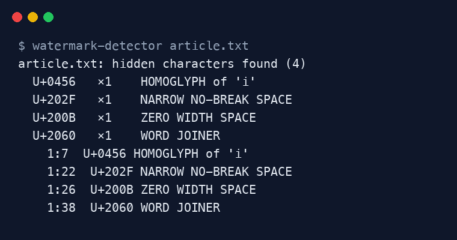

<div align="center">

# Text Watermark Detector

**Reveal invisible characters, hidden Unicode messages and look-alike letters in any text.**

[](https://github.com/ksanyok/watermark-detector/actions/workflows/ci.yml) [](LICENSE)   [](https://promopilot.link/en/tools/watermark-detector.php?utm_source=github&utm_medium=repo&utm_campaign=tools&utm_content=watermark-detector)

**[▶ Use the free online version — no install, no sign-up](https://promopilot.link/en/tools/watermark-detector.php?utm_source=github&utm_medium=repo&utm_campaign=tools&utm_content=watermark-detector)**

</div>

`watermark-detector` scans text for characters you cannot see: zero-width spaces and joiners, non-breaking and narrow spaces, bidirectional controls, Unicode *tag characters* that can carry an entire hidden message, stray variation selectors and Cyrillic/Greek letters disguised as Latin ones. It tells you what each one is, where it sits (line:column), and can strip them out.



## What it checks

- **Zero-width characters** — ZWSP, ZWNJ, ZWJ, word joiner, BOM, soft hyphen, invisible math operators, Hangul fillers
- **Unusual spaces** — no-break, narrow no-break (common in AI output), en/em/thin/hair spaces, line and paragraph separators
- **Bidi controls** — RLO/LRO overrides and isolates used in "Trojan Source" tricks and spoofed file names
- **Unicode tag characters** (U+E0000 block) — decodes the hidden ASCII message ("ASCII smuggling", prompt injection)
- **Variation selectors** outside emoji sequences (a known way to embed data in text)
- **Homoglyphs** — Cyrillic and Greek letters inside Latin words (`pаypal` with a Cyrillic *а*)
- **Typography** (opt-in) — curly quotes, long dashes and ellipses that often survive copy-paste from chat UIs

## Why it matters

Text pasted from chat assistants, word processors and web pages often carries characters that are invisible on screen but very real for software: they break search and string matching, split words for spell-checkers and SEO tools, leak into URLs and code, and can be used to fingerprint or watermark a document. Some are malicious — tag characters can hide instructions for LLMs, bidi overrides can make code or file names read differently from how they run. A quick scan makes all of that visible.

## Quick start

```bash
# run straight from GitHub, nothing to install
npx github:ksanyok/watermark-detector article.txt

# or install the CLI globally
npm install -g github:ksanyok/watermark-detector
watermark-detector article.txt
```

Scan one or more files:

```bash
watermark-detector article.txt docs/
```

Scan text from the clipboard (macOS) or another command:

```bash
pbpaste | watermark-detector
```

Clean a file in place (spaces normalised, invisible characters removed):

```bash
watermark-detector draft.md --clean --write
```

Block hidden characters in CI or a pre-commit hook:

```bash
watermark-detector content/ --fail
```

## Example output

```text
article.txt: hidden characters found (4)
  U+0456   ×1    HOMOGLYPH of 'i'
  U+202F   ×1    NARROW NO-BREAK SPACE
  U+200B   ×1    ZERO WIDTH SPACE
  U+2060   ×1    WORD JOINER
    1:7  U+0456 HOMOGLYPH of 'i'
    1:22  U+202F NARROW NO-BREAK SPACE
    1:26  U+200B ZERO WIDTH SPACE
    1:38  U+2060 WORD JOINER
```

## CLI

```text
Usage: watermark-detector [file|folder ...] [options]
       cat text.txt | watermark-detector

Finds hidden characters in text: zero-width spaces, unusual spaces, bidi controls,
Unicode tag characters (hidden messages), variation selectors and Latin look-alikes.

Options:
  --clean           Print the cleaned text instead of a report
  --write           With --clean: overwrite the input files in place
  --typography      Also report curly quotes, long dashes and ellipses
  --no-homoglyphs   Do not report Cyrillic/Greek look-alike letters
  --json            Print findings as JSON
  --fail            Exit with code 1 when anything is found (for CI / pre-commit)
  -h, --help        Show this help

Online version (no install): https://promopilot.link/en/tools/watermark-detector.php
```

## Use as a library

```js
import { detect, summarize, clean, decodeTags } from '@promopilot/watermark-detector';

const text = 'Our pr\u0456cing starts at\u202f$9.\u200b';
const findings = detect(text);          // [{ index, line, column, code: 'U+202F', name, category }, ...]
const report = summarize(text, findings); // { total, byCategory, byCode, verdict: 'clean' | 'suspicious' | 'marked', hiddenMessage }
const safe = clean(text);                 // 'Our prіcing starts at $9.' with spaces normalised

decodeTags(untrustedPrompt);              // reveal text hidden in U+E0000 tag characters
```

Options for `detect` / `clean`: `{ typography: false, homoglyphs: true }`. Verdicts: **clean** — nothing found; **suspicious** — only spacing/typography anomalies (often harmless); **marked** — zero-width, tag, bidi, variation-selector, control or homoglyph characters were found.

## Use in CI (GitHub Actions)

Keep invisible characters out of your docs, translations or content repository:

```yaml
- uses: ksanyok/watermark-detector@v1
  with:
    args: content/ --fail
```

## How it works

The scanner walks the text by Unicode code point (so emoji and astral characters are handled correctly) and looks each one up in a curated table of about 60 characters plus three ranges: tag characters, variation selectors and C0/C1 controls. Context rules avoid false positives: a variation selector or ZWJ right after an emoji is part of a normal emoji sequence, and a Cyrillic letter is only reported as a homoglyph when it touches a Latin letter. Everything is local — no network, no telemetry.

## CLI vs. online version

| | This package | [Online tool](https://promopilot.link/en/tools/watermark-detector.php?utm_source=github&utm_medium=repo&utm_campaign=tools&utm_content=watermark-detector) |
|---|---|---|
| Runs on | Your machine, CI, editors, scripts | Any browser |
| Input | Files, folders, stdin | Paste text |
| Cleaning | `--clean`, `--write` in place | One-click clean and copy, highlighted text |
| Extras | Exit codes for CI | Visual highlighting, explanation of each character |
| Price | Free, MIT | Free, no sign-up |

## FAQ

<details>
<summary><b>Does ChatGPT put watermarks in its text?</b></summary>

OpenAI has said it does not add a hidden watermark to ChatGPT text. Still, text copied from chat interfaces often contains narrow no-break spaces (U+202F), non-breaking spaces and other formatting characters introduced by rendering and copy-paste. They are not a reliable AI signal on their own, but they are worth cleaning before publishing.
</details>

<details>
<summary><b>Can this tool tell me whether a text was written by AI?</b></summary>

No. It finds characters, not writing style. Removing invisible characters does not make text "human", and a clean result does not prove a human wrote it. For a style-based estimate use an AI detector; PromoPilot has a free one.
</details>

<details>
<summary><b>What are Unicode tag characters and why do they matter?</b></summary>

Characters U+E0020–U+E007E mirror printable ASCII but render as nothing. They can carry a whole sentence inside seemingly normal text — a technique used for prompt injection against LLMs ("ASCII smuggling"). The detector decodes and shows that hidden text.
</details>

<details>
<summary><b>Will cleaning break my text?</b></summary>

It removes characters that are invisible and replaces odd spaces with a regular space. Typography (curly quotes, dashes) is only touched with `--typography`. Emoji sequences are preserved. Languages that legitimately use ZWJ/ZWNJ (Persian, Hindi and others) may need `--clean` to be reviewed before writing.
</details>

<details>
<summary><b>Does any text leave my computer?</b></summary>

No. The package has no network code at all.
</details>

<details>
<summary><b>Is there a version without installing anything?</b></summary>

Yes — the [online Watermark Detector](https://promopilot.link/en/tools/watermark-detector.php?utm_source=github&utm_medium=repo&utm_campaign=tools&utm_content=watermark-detector) highlights hidden characters right in the text and cleans it in one click.
</details>

## Related free tools

- [Invisible Character Remover](https://promopilot.link/en/tools/invisible-character-remover.php?utm_source=github&utm_medium=repo&utm_campaign=tools&utm_content=invisible-character-remover) — free online tool
- [Ai Text Cleaner](https://promopilot.link/en/tools/ai-text-cleaner.php?utm_source=github&utm_medium=repo&utm_campaign=tools&utm_content=ai-text-cleaner) — free online tool
- [Image Watermark Detector](https://promopilot.link/en/tools/image-watermark-detector.php?utm_source=github&utm_medium=repo&utm_campaign=tools&utm_content=image-watermark-detector) — free online tool
- [Ai Detector](https://promopilot.link/en/tools/ai-detector.php?utm_source=github&utm_medium=repo&utm_campaign=tools&utm_content=ai-detector) — free online tool
- [Favicon Checker](https://github.com/ksanyok/favicon-checker) — audit every favicon a site declares, with real pixel sizes ([online](https://promopilot.link/en/tools/favicon-checker.php?utm_source=github&utm_medium=repo&utm_campaign=tools&utm_content=favicon-checker))
- [All 120+ free SEO, email and web tools](https://promopilot.link/en/tools/?utm_source=github&utm_medium=repo&utm_campaign=tools&utm_content=watermark-detector)

## Contributing

Bug reports and pull requests are welcome — see [CONTRIBUTING.md](CONTRIBUTING.md). Security issues: [SECURITY.md](SECURITY.md).
More docs live in the [wiki](https://github.com/ksanyok/watermark-detector/wiki).

## License

[MIT](LICENSE) © 2026 Alexandr Krikun

---

<sub>Built and maintained by the team behind [PromoPilot](https://promopilot.link/?utm_source=github&utm_medium=repo&utm_campaign=tools&utm_content=watermark-detector) — link building, SEO monitoring and 120+ free tools for site owners. Also on [YouTube](https://www.youtube.com/channel/UCPB8m7BgaexcZh0Vr49ViYA).</sub>
